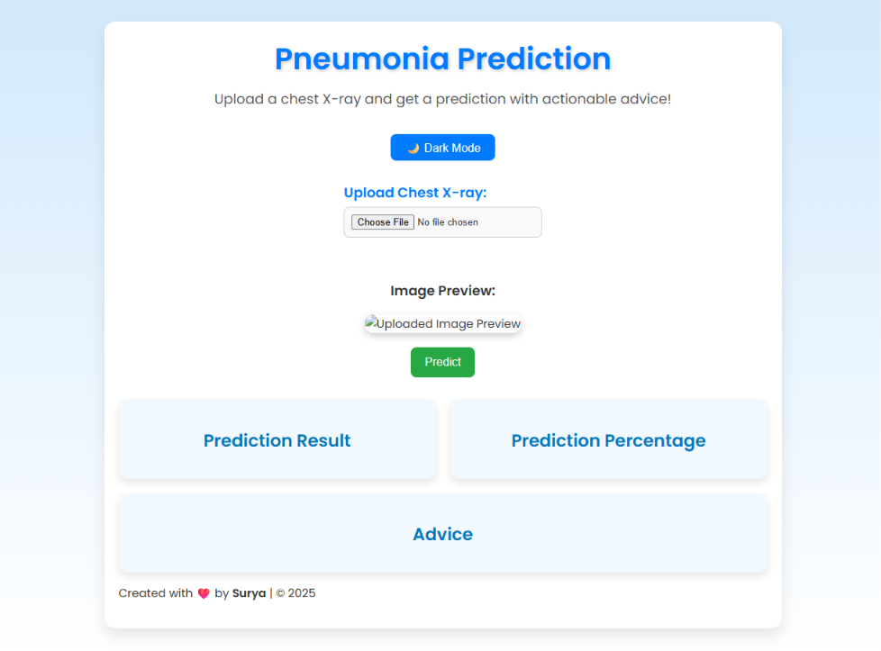
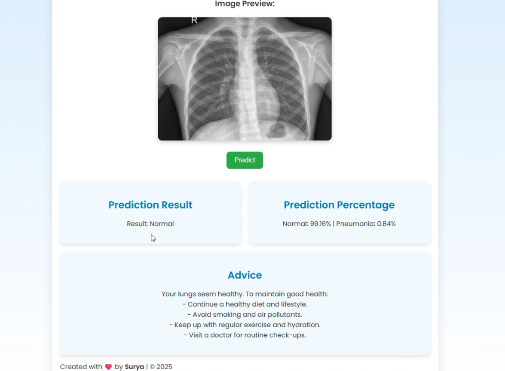
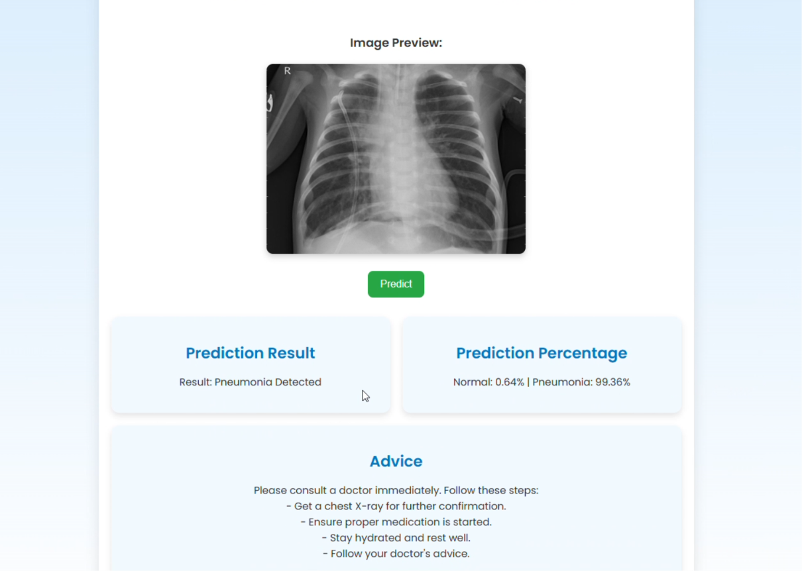

# PneumoniaAI — AI-Powered Pneumonia Detection System

PneumoniaAI is a Django web application that uses a trained convolutional neural network (CNN) to analyze uploaded chest X-ray images and return an AI-assisted prediction.

> **Medical disclaimer:** This project is for educational and research purposes only. It is not a medical device and must not be used to diagnose, treat, or rule out pneumonia. Always consult a qualified healthcare professional.

## Features

- Upload a chest X-ray image through a web interface.
- Preview the selected image before requesting a prediction.
- Resize and normalize the image before model inference.
- Display the model's pneumonia and normal prediction percentages.
- Show general follow-up advice based on the prediction.
- Toggle between light and dark themes.

## Tech stack

- Python
- Django
- TensorFlow / Keras
- Convolutional Neural Network (CNN)
- NumPy
- Pillow
- Scikit-learn (for machine-learning workflows, if used in model development)

## Model performance

The project description reports **89%+ classification accuracy**. Results depend on the dataset, preprocessing, evaluation method, and model version. This figure should not be interpreted as clinical accuracy or a guarantee of correct predictions.

## Project structure

```text
.
├── manage.py
├── pneumonia_website/
│   ├── settings.py
│   └── urls.py
└── predictor/
    ├── model/
    │   └── best_pneumonia_model.h5
    ├── templates/
    │   └── predictor/
    │       └── index.html
    ├── static/
    ├── urls.py
    └── views.py
```

## Run locally

### Prerequisites

- Python installed on your system
- A Python version supported by the TensorFlow version you install
- The trained model file at `predictor/model/best_pneumonia_model.h5`

### 1. Open the project folder

In PowerShell, change to the directory containing `manage.py`:

```powershell
cd "path\to\pneumonia_website"
```

### 2. Create and activate a virtual environment

```powershell
py -m venv .venv
.\.venv\Scripts\Activate.ps1
```

### 3. Install dependencies

```powershell
python -m pip install --upgrade pip
python -m pip install Django tensorflow numpy Pillow
```

TensorFlow and Keras must be compatible with the saved `.h5` model. If the model fails to load, check the full error and use compatible TensorFlow/Keras versions.

### 4. Apply database migrations

```powershell
python manage.py migrate
```

### 5. Start the development server

```powershell
python manage.py runserver
```

Open [http://127.0.0.1:8000/](http://127.0.0.1:8000/) in your browser. Stop the server with `Ctrl+C`.

## Prediction endpoint

The application accepts image uploads at:

```text
POST /predict/
```

Send the image as multipart form data using the field name `file`.

A successful response contains:

```json
{
  "result": "Normal",
  "pneumonia_percentage": 12.5,
  "normal_percentage": 87.5,
  "advice": "..."
}
```

The displayed percentages are model outputs, not a medical diagnosis.

## Application Screenshots

🏠 Homepage


✅ Normal Chest X-Ray Prediction


🩺 Pneumonia Detection Result


🎬 Project Demo

Watch the recorded demonstration of PneumoniaAI, including the image upload and prediction workflow.

▶️ View the PneumoniaAI Demo Video

## Notes

- The model is loaded by the Django application when the prediction view is imported. The model file must exist at the expected path, and the installed TensorFlow/Keras versions must be able to load it.
- Django's development server is intended for local development, not production deployment. Before deploying, configure production settings, static-file serving, secrets, and a production application server.

## Author

**Surya**

Created as an educational project for AI-assisted pneumonia detection from chest X-ray images.
